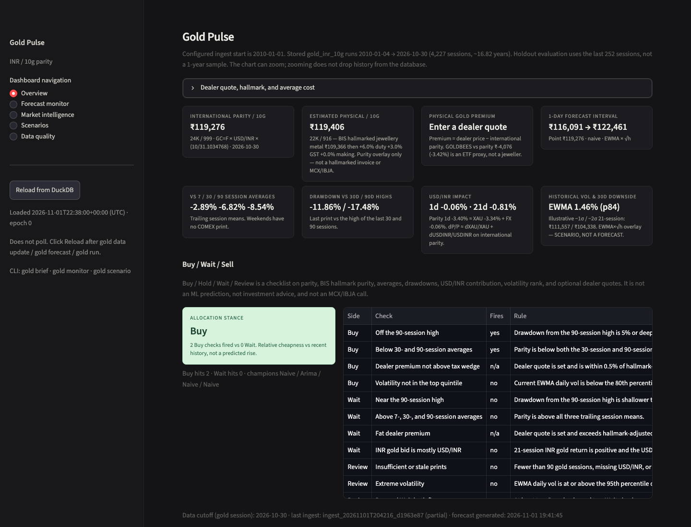
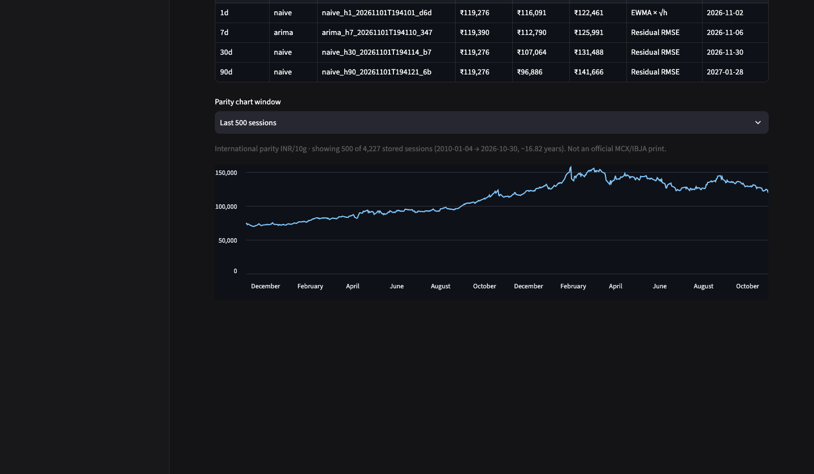

# Gold Pulse

Gold Pulse is a research dashboard for **Indian rupee gold**, built around one honest number: the international price of gold converted to **INR per 10 grams**. It is meant for someone who wants to see what COMEX and the rupee imply for jewellery and bars, how far today’s print sits from recent averages, and whether a dealer quote is a fat premium without pretending we have licensed MCX or IBJA prints.

The app lives on your machine. It downloads public market history, stores it in DuckDB, and serves a Streamlit overview plus a terminal brief. It is **not** trading advice.

Current Version - **v1.1**

---

## What we are trying to do

Rupee gold is not a single series. COMEX gold in dollars, USD/INR, import duty, GST, BIS hallmark purity, and the jeweller’s making charge all sit on top of each other. Official MCX futures and IBJA AM/PM benchmarks are licensed; this project does not scrape or invent them.

So Gold Pulse does three things:

1. **Build a clean international parity series** from 2010 onward, leak-free, and forecast it at 1, 7, 30, and 90 days with models that have to beat a naive “no change” benchmark.
2. **Translate that parity into a physical estimate** a buyer can compare to a real quote: 22K / 916 hallmark (or 24K / 18K / 14K), plus duty and GST.
3. **Show a transparent Buy / Wait / Sell checklist** on drawdowns, moving averages, USD/INR contribution, volatility, and dealer premium. Every check has a written rule. None of it is an unsupported model call.

The identity behind the target is:

```
gold_inr_10g  =  COMEX gold (USD/oz)  ×  USD/INR  ×  (10 / 31.1034768)
```

That is **24K / 999 international parity**. It excludes duty, GST, making, and local premium. GOLDBEES is kept as an onshore ETF proxy and is labelled as such — it is not IBJA.

Hallmarked jewellery is then:

```
estimated physical  =  parity × (fineness / 999) × (1 + duty) × (1 + GST) × (1 + making)
```

The headline extra metric is:

```
Physical Gold Premium  =  dealer quote  −  international parity
```

---

## The dashboard

Open **Gold Pulse** after the first data load. Overview is the daily page: parity, hallmark-adjusted physical, the 1-day forecast interval in full (not truncated), averages, drawdowns, USD/INR impact, and the coloured Buy / Wait / Sell chip.



The chart can show the last 90 sessions, a year, 500 sessions, or the **full sample from 2010**. Zooming the chart does not drop history from the database.



Enter a jeweller quote and your average purchase cost if you have them. Buy is light green, Wait is light yellow, Sell is light red. The table next to the chip lists which rules fired.

---

## Models and holdout metrics

The production target is the **h-day log return** of `gold_inr_10g`, reconstructed as `price = close[t] × exp(ŷ)`. Training is chronological: an expanding window across five market regimes, then a final holdout of the last **252 sessions**. A model is promoted only if it beats naive on that holdout **and** on at least three of the five regimes. Tree models (XGBoost, LightGBM) were tried and are **not** champions.

Pipeline version: `v2-logret`.

| Horizon | Champion | Holdout MAPE | Holdout MAE (INR / 10g) | Interval |
|---|---|---|---|---|
| 1 calendar day | naive | 1.32% | 1,782 | causal EWMA × √h |
| 7 calendar days | ARIMA | 2.92% | 3,942 | residual RMSE |
| 30 calendar days | naive | 5.81% | 7,827 | residual RMSE |
| 90 calendar days | naive | 10.81% | 14,522 | residual RMSE |

Naive means “tomorrow equals today’s close” in return space. ARIMA at 7 days is a 0.04% near-tie that still cleared the written rule. Intervals are not guaranteed coverage. Scenario packs (bull / bear / stress) are identity what-ifs and are labelled **not a forecast**.

---

## Data we use

Ingest is configured from **2010-01-01**. On a current run, `gold_inr_10g` has about **4,200 daily sessions** from **2010-01-04** through the latest COMEX print — roughly **17 years**, not one year.

| Series | Source | Role |
|---|---|---|
| COMEX gold `GC=F` | Yahoo Finance | Dollar gold |
| USD/INR `INR=X` | Yahoo Finance | Rupee |
| `gold_inr_10g` | derived | Primary target (parity) |
| DXY, US 10y, WTI | Yahoo Finance | Drivers |
| 10y TIPS real yield | US Treasury | Real rates |
| GOLDBEES | Yahoo Finance | Onshore ETF proxy, not IBJA |
| India CPI | World Bank | Lagged macro |
| Import duty, RBI repo, festivals | curated tables in `config/` | Policy / calendar |
| MCX gold futures | unavailable | Licensed — left empty |
| IBJA gold | unavailable | Licensed — left empty |

Everything is stored as **DuckDB + Parquet** under `data/` on your disk. Look-ahead is blocked by joining exogenous series only when `available_at ≤ feature_date`.

---

## How to run it

You need Python 3.11+ and a network connection for the first download.

```bash
git clone https://github.com/VishaalChandrasekar0203/GoldPulse.git
cd GoldPulse
python3 -m venv .venv
source .venv/bin/activate
pip install -U pip
pip install -e ".[dev,ui]"
```

Then, once, build the book (about 5–15 minutes):

```bash
gold init
gold data update
gold features build
gold train --all
gold forecast --horizon all
gold ui
```

The browser opens [http://127.0.0.1:8501](http://127.0.0.1:8501). After that, a morning refresh is `gold run` (it does not retrain) and `gold brief` if you want the same numbers in the terminal. Click **Reload from DuckDB** in the sidebar after a refresh — the UI does not poll.

Do not put `# comments` on the same line as a `gold` command; the CLI will treat them as extra arguments.

`gold train --all` is the only way champions change. `gold run` locks, backs up, ingests, forecasts if the tape is fresh, and scores outcomes.

---

## Project layout

```
config/     source catalog, duty / repo / festival tables
src/gold/   ingest, DuckDB, features, models, forecast, ops, CLI, UI
tests/      unit and integration tests
docs/       research notes and UI screenshots
scripts/    daily.sh for cron or launchd
data/       created on your machine — not in git
```

---

## Disclaimer

Forecasts can be wrong. Intervals are not guaranteed. Buy / Wait / Sell is a checklist, not a recommendation. Scenarios are identity overlays. Official MCX and IBJA prints are not in this database. Do not treat Gold Pulse as investment, trading, or tax advice.
